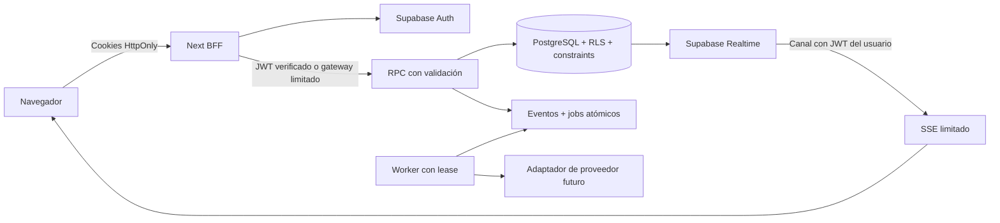

# Arquitectura

Monolito modular Next.js App Router / TypeScript / React. Supabase Auth proporciona identidad; PostgreSQL proporciona autorización y operaciones de dominio transaccionales. El navegador llama endpoints del mismo origen; la sesión viaja en cookies HttpOnly. El cliente Supabase y los JWT quedan en servidor. Los endpoints públicos de Next actúan como gateway limitado: secreto específico para booking, sin service_role. Los helpers privilegiados viven en `app_private`; los RPC expuestos son wrappers SECURITY INVOKER con grants explícitos.

Todas las escrituras comerciales se realizan por RPC para mantener validaciones, auditoría, eventos e idempotencia en la misma transacción. SELECT protegido por RLS y paginación. Configuración usa una lista explícita de objetos permitidos, referencias compuestas y autorización específica por objeto. No se acepta SQL o nombres de tabla arbitrarios.

Staff es independiente de Auth. Membresía activa + perfil activo + roles + sucursales determinan acceso. Platform admins se administran por bootstrap privilegiado, fuera de metadata editable. Clientes organizacionales tienen acceso restringido según sucursales relevantes y staff asignado.

Disponibilidad: intersección de horario de sucursal y reglas/excepciones del staff, menos cierres, time off y citas. Exclusión GiST por UUID de staff, sin branch en la exclusión, protege simultaneidad entre sucursales. Servicios compuestos calculados en DB y snapshots de duración/precio para preservar historia.

Outbox transaccional `domain_events` + `automation_jobs`, worker con lease y retries; proveedores externos después del commit. Métricas diarias por dimensión, recalculables desde citas. Realtime únicamente para filas operativas visibles; canal limpio al salir y refetch limitado tras reconexión.

Finanzas operativas se agregan al núcleo; oportunidades comerciales siguen fuera. La arquitectura permite agregar módulos sin duplicar organización, sucursal, cliente, staff ni cita.

Auditoría inicial: [AUDIT.md](AUDIT.md). Los resultados medidos y límites de verificación se registran en `VERIFICATION.md` al terminar.

## Límites de dominio

`features/` separa organizaciones, configuración, clientes, servicios, agenda, booking público, walk-ins, analytics y metas. `lib/` concentra Auth, validación, HTTP y Supabase server; `hooks/` maneja reloj y suscripciones. Las reglas críticas viven en migrations versionadas. La configuración usa un editor compartido para evitar CRUD duplicado, con definiciones por entidad y whitelist independiente en PostgreSQL.

No se crearon microservicios. Next sirve como BFF, renderizador y worker HTTP; PostgreSQL mantiene transacciones y outbox. SSE conecta Realtime autenticado desde servidor y transmite solamente tabla/ID/tipo; el navegador solicita el registro autorizado actualizado. Las integraciones de calendarios y WhatsApp quedan fuera del núcleo.

La moneda usa unidades menores enteras y precios opcionales. Los reportes muestran valor estimado solo para servicios con precio; no representan cobros. Cambiar moneda se bloquea cuando ya hay precios o historial valuado. Metas usan días locales completos y fin exclusivo.

## Continuación financiera — 12/10/2026

Cuatro migrations financieras aditivas conservan las 15 originales y las entidades operativas. Venta/pago/fee/comisión/gasto/caja/liquidación separados; lock tenant, idempotencia, snapshots, RLS, audit y eventos privados. Agregados diarios acotados. Booking contrato website_booking_version=1, website_category/consultation_required y deep link service validado contra catálogo. Consulta previa no permite reserva pública directa. 1717barber consume este contrato con un único motor de booking.
